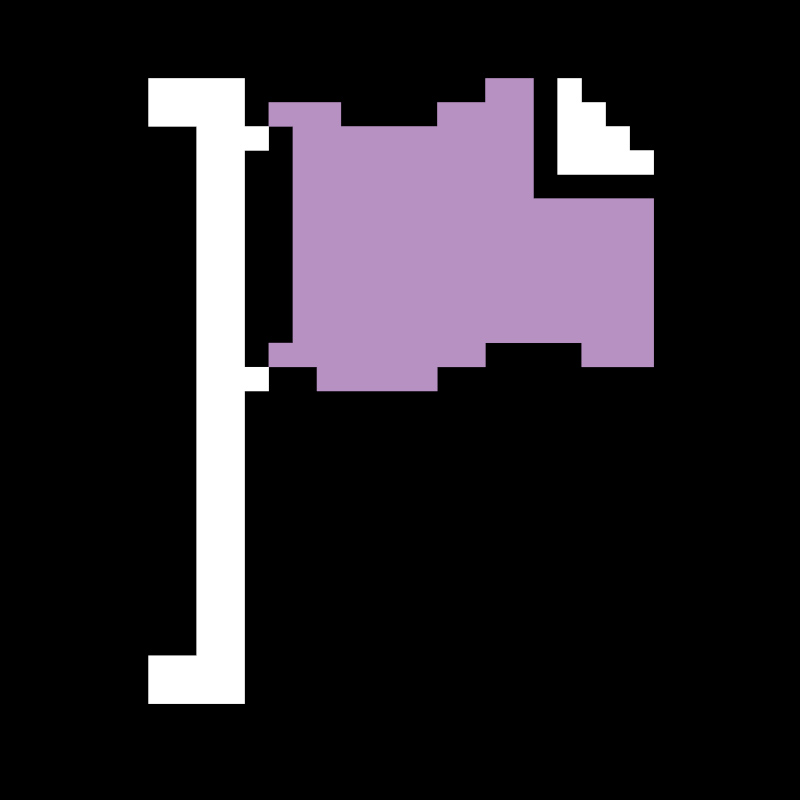

<p align="center">
  <a href="https://loganportfolio.savepoint.co.nz"></a>
</p>

<h1 align="center">Logan Young: Portfolio</h1>

<p align="center">
  The source for <a href="https://loganportfolio.savepoint.co.nz">loganportfolio.savepoint.co.nz</a>: Logan Young's projects, client work and contact details, with a green take on Save Point's 8-bit branding.<br>
  Built and run by <a href="https://savepoint.co.nz"><b>Save Point Limited</b></a>, New Zealand.
</p>

<p align="center">
  <a href="https://loganportfolio.savepoint.co.nz">Live site</a> ·
  <a href="https://loganportfolio.savepoint.co.nz/legal">Legal</a> ·
  <a href="SECURITY.md">Security</a> ·
  <a href="LICENSE">Licence</a>
</p>

---

> [!IMPORTANT]
> This is a personal portfolio and proprietary software. The code is public so visitors and employers can see how it's built. It is **not** open source, and it is not a template: please don't copy or redeploy it. See [LICENSE](LICENSE).

## What's on it

| Route | What it is |
|---|---|
| `/` | Intro, featured projects, Save Point teaser |
| `/projects` | Every project, grouped by category, with screenshots and links (data in `app/data/projects.ts`) |
| `/about` | Background and skills |
| `/save-point` | About Save Point Limited |
| `/contact` | Contact details |
| `/legal` | Privacy policy, cookie policy, website terms and disclaimer |

There is no backend, database, analytics or tracking. Every page is static.

## Built with

- **Next.js 16** (App Router) and **React 19**, TypeScript
- Hand-written **CSS Modules**, using Save Point's brand colours with green as the accent
- Self-hosted on **loganserver**, Logan's Ubuntu home server: a Docker Compose stack behind a local-only Caddy reverse proxy, reached through a **Cloudflare Tunnel**, so no ports are open to the internet.

## Project layout

```
logan-portfolio/
├── portfolio-website/            # The Next.js app
│   ├── app/
│   │   ├── layout.tsx  page.tsx  # Root layout and home page
│   │   ├── about/  contact/  legal/  projects/  save-point/   # One folder per route
│   │   ├── components/           # navBar, footer, pageHero, projectCard, pixelFlag
│   │   ├── data/projects.ts      # Every project shown on the site
│   │   ├── shared/               # Shared CSS modules
│   │   ├── globals.css           # Brand colours and fonts
│   │   └── not-found.tsx         # 404 page
│   ├── lib/utils.ts              # cn() class-merging helper
│   ├── public/                   # Photos and project screenshots
│   ├── Dockerfile  docker-compose.yml   # Production container on loganserver (joins the shared `proxy` network)
│   ├── next.config.ts  tsconfig.json  eslint.config.mjs  postcss.config.mjs
│   └── package.json
├── LICENSE                       # All rights reserved
├── SECURITY.md
└── README.md
```

## Running it locally

Requires Node.js 20 or newer.

```sh
cd portfolio-website
npm install
npm run dev      # http://localhost:3000
```

| Script | What it does |
|---|---|
| `npm run dev` | Development server with hot reload |
| `npm run build` | Production build |
| `npm run start` | Serve the production build |
| `npm run lint` | ESLint |

No environment variables are needed. If any are added later, put them in `portfolio-website/.env.local`; every `.env*` file is git-ignored.

## Deploying

The live site runs on loganserver:

```sh
cd portfolio-website
docker compose up -d --build   # builds the Next.js image and starts the `portfolio` container
```

The container has no published ports. It joins the external `proxy` Docker network, where the shared Caddy proxy routes `loganportfolio.savepoint.co.nz` to it, and the Cloudflare Tunnel on loganserver carries that hostname in from the internet.

## Ownership

The site code is © 2025–2026 Save Point Limited, a New Zealand company (company number 9392145). The photos, biography and written content are © Logan Young. All rights reserved.

- Website: [savepoint.co.nz](https://savepoint.co.nz)
- Contact: [logan@savepoint.co.nz](mailto:logan@savepoint.co.nz)
- Support and security: [support@savepoint.co.nz](mailto:support@savepoint.co.nz)

"Save Point" and the Save Point flag logo are the property of Save Point Limited. Project screenshots of client work are shown with permission and belong to their owners.
